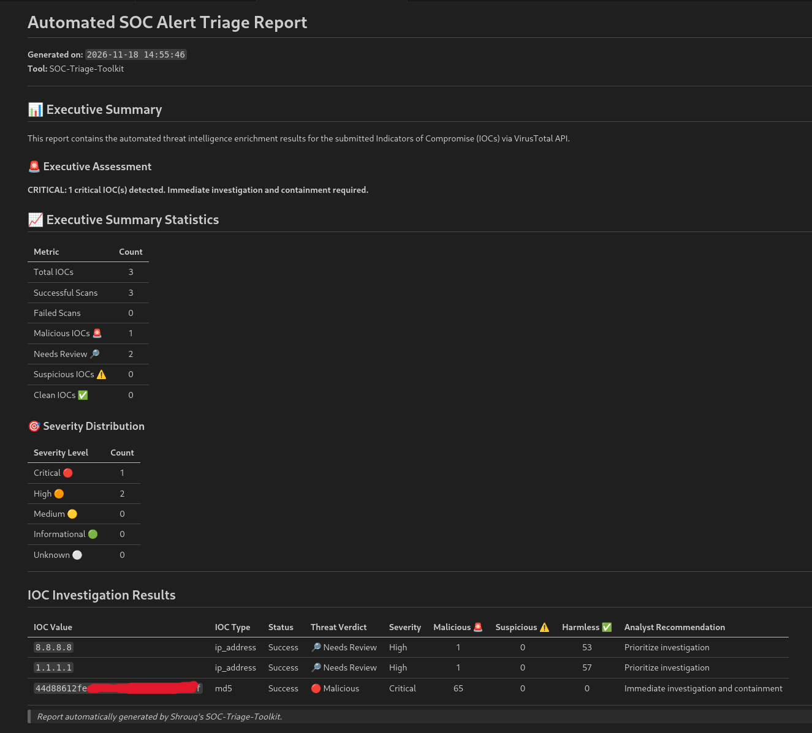
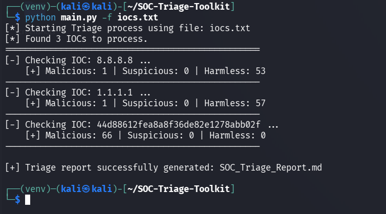

# 🛡️ SOC Triage & Enrichment Toolkit

**أداة الفحص الأولي لمؤشرات الاختراق وإثراء المعلومات الأمنية وتوليد التقارير تلقائيًا**

أداة خفيفة ومؤتمتة مطوّرة بلغة Python، تهدف إلى مساعدة محللي مركز عمليات الأمن (SOC) في تسريع عملية الفحص الأولي للحوادث الأمنية من خلال تحليل مؤشرات الاختراق (Indicators of Compromise - IOCs)، والاستفادة من معلومات التهديدات الأمنية عبر VirusTotal API v3، ثم إنشاء تقارير منظمة بصيغة Markdown.

يهدف المشروع إلى تطبيق بعض المهام الأساسية ضمن سير عمل محلل SOC، مع توظيف البرمجة والأتمتة لتسهيل عمليات الفحص والتحليل الأولي.

---

## 🚀 المميزات الرئيسية

* **التحقق التلقائي من التهديدات:** الاستعلام تلقائياً عن طريق **VirusTotal API v3** لفحص عناوين الـ IP، روابط الـ URL وقيم الـ Hashes (MD5/SHA256/SHA1).
* **التعرف الذكي على الـ IOCs:** التمييز بذكاء بين عناوين الشبكات (IPs) وهاشات الملفات.
* **إثراء المعلومات الأمنية (Threat Intelligence Enrichment):** جمع نتائج الفحص من VirusTotal لدعم التحليل الأولي وتصنيف Verdict.
* **توليد التقارير تلقائياً:** إنشاء تقارير تحقيق جاهزة ونظيفة (`SOC_Triage_Report.md`) تتضمن إحصائيات الخطورة وتوزيعات التهديدات (Malicious, Suspicious, Harmless).
* **تقييم مستوى الخطورة:** تقديم تقييم تنفيذي (Executive Assessment) استنادًا إلى نتائج اكتشاف المؤشرات الضارة.
* **معالجة الأخطاء (Error Handling):** التعامل باحترافية مع أخطاء الملفات، مثل عدم وجود الملف، الملفات الفارغة، مشكلات الصلاحيات (`PermissionError`)، وأخطاء نظام التشغيل (`OSError`).
* **إدارة مفاتيح API بأمان:** استخدام ملفات البيئة `.env` لإدارة مفاتيح الـ API بسرية وأمان تامة بعيداً عن الشيفرة البرمجية.
* **الاختبارات البرمجية (Unit Testing):** تضمين حزمة اختبارات آلية شاملة (Unit Tests) للتحقق من وظائف الأداة وسلوكها في حالات النجاح والفشل.

---

## 🏗️ هيكل المشروع

يوضح الجدول التالي مكونات المشروع وملفاته الأساسية:

| المسار / الملف | النوع | الوصف المختصر |
| :--- | :---: | :--- |
| `main.py` | ملف أساسي | ملف التشغيل الرئيسي للتحكم واستقبال الأوامر (CLI). |
| `requirements.txt` | ملف تكوين | يحتوي على المكتبات البرمجية المطلوبة لتشغيل الأداة. |
| `.env` | ملف سري | تخزين مفاتيح الـ API بشكل آمن (يتم استثنائه من Git). |
| `iocs.txt` | ملف مدخلات | ملف تجريبي يحتوي على مؤشرات الاختراق (IOCs) المراد فحصها. |
| `SOC_Triage_Report.md` | ملف مخرجات | تقرير التحقيق النهائي الناتج بصيغة Markdown تلقائياً. |
| `modules/__init__.py` | موديول | تعريف مجلد الموديولات البرمجية. |
| `modules/vt_checker.py` | موديول | المسؤول عن التكامل مع VirusTotal API وفحص الـ IOCs. |
| `modules/reporter.py` | موديول | المسؤول عن هندسة وبناء تقارير الـ Markdown. |
| `screenshots/` | مجلد | يحتوي على لقطات الشاشة وتوضيح عمل الأداة في الـ README. |

```text
SOC-Triage-Toolkit/
│
├── main.py
├── requirements.txt
├── .env
├── .gitignore
├── iocs.txt
│
├── modules/
│   ├── __init__.py
│   ├── vt_checker.py
│   └── reporter.py
│
├── tests/
│   ├── test_main.py
│   ├── test_vt_checker.py
│   └── test_reporter.py
│
└── screenshots/
    ├── triage_output.png
    └── report_preview.png
```

## التثبيت والإعداد
1- نسخ المستودع (Clone):
```
git clone [https://github.com/shrouqobaid/SOC-Triage-Toolkit.git](https://github.com/shrouqobaid/SOC-Triage-Toolkit.git)

cd SOC-Triage-Toolkit

```
2- إنشاء وتفعيل البيئة الافتراضية:

```
python3 -m venv venv
```

```
source venv/bin/activate
```
3- تثبيت المتطلبات:
```
pip install -r requirements.txt
```
4- إعداد مفتاح الـ API:
أنشئ ملف باسم .env في المجلد الرئيسي للمشروع وأضف مفتاح VirusTotal الخاص بك:

```
VIRUSTOTAL_API_KEY=your_actual_api_key_here
```


## طريقة الاستخدام:
قم بإعداد ملف نصي (مثل iocs.txt) يحتوي على مؤشرات الاختراق (مؤشر واحد في كل سطر):

```
8.8.8.8
```

- تشغيل الأداة:
```
python main.py -f iocs.txt
```
يمكن أيضًا تحديد مسار مخصص لحفظ التقرير الناتج باستخدام الخيار -o:
```
python main.py -f iocs.txt -o reports/triage_report.md
```
بعد اكتمال عملية الفحص، تنشئ الأداة تقريرًا بصيغة Markdown (SOC_Triage_Report.md) يتضمن نتائج تحليل المؤشرات والإحصائيات والتقييم التنفيذي.

---

## الاختبارات البرمجية (Testing)
يتضمن المشروع مجموعة متكاملة من اختبارات الوحدة (Unit Tests) للتحقق من صحة الوظائف الأساسية والتعامل مع الأخطاء المحتملة.

لتشغيل جميع الاختبارات:
```
python -m unittest discover -s tests -v
```

## تشمل الاختبارات:

- التحقق من صحة تصنيف مؤشرات الاختراق.
- اختبار استجابات VirusTotal API ومعالجة أخطاء الاتصال والاستجابة.
- التحقق من نجاح وفشل إنشاء التقارير.
- اختبار الملفات غير الموجودة (`nonexistent.txt`) والملفات الفارغة.
- اختبار أخطاء الصلاحيات (`PermissionError`) ونظام الملفات (`OSError`).
- التحقق من نجاح سير عمل الفحص الأساسي (`Successful Triage`).

## صور توضيحية
تنفيذ الأداة والفحص عبر الـ Terminal:



## التقنيات والأدوات المستخدمة
| التقنية / الأداة | التصنيف | الوصف المختصر |
| :--- | :---: | :--- |
| `Python 3` | لغة البرمجة | تطوير الأداة وأتمتة عمليات الفحص. |
| `VirusTotal API v3` | واجهة برمجة | الحصول على معلومات التهديدات الأمنية. |
| `Requests` | مكتبة برمجية | تنفيذ طلبات HTTP والتواصل مع API. |
| `Python-dotenv` | مكتبة برمجية | إدارة متغيرات البيئة ومفاتيح API بأمان. |
| `Unittest` | إطار عمل | كتابة وتشغيل الاختبارات البرمجية (Unit Tests). |
| `Git & GitHub` | أدوات إدارة | إدارة الإصدارات وحفظ المشروع. |
| `Kali Linux` | بيئة التشغيل | بيئة التطوير والاختبار الأمني. |


## 🎯 الهدف من المشروع

يهدف هذا المشروع إلى تطبيق مفاهيم ومهام عملية مرتبطة بعمل محلل مركز عمليات الأمن (SOC Analyst)، من خلال:

- أتمتة الفحص الأولي لمؤشرات الاختراق.
- استخدام مصادر Threat Intelligence لإثراء نتائج التحليل.
- التعامل مع واجهات API الأمنية.
- تطوير مهارات Python Automation.
- تطبيق مبادئ Error Handling وUnit Testing.
- إنشاء تقارير منظمة تدعم توثيق نتائج الفحص الأولي..

--- 

يمثل المشروع تطبيقًا عمليًا يجمع بين مفاهيم الأمن السيبراني والبرمجة والأتمتة، مع التركيز على مهام Blue Team وSOC Operations.

تطوير: Shrouq Obaidallah Almejireshi

المجالات: Cybersecurity | Blue Team | SOC Operations | Python Automation 
